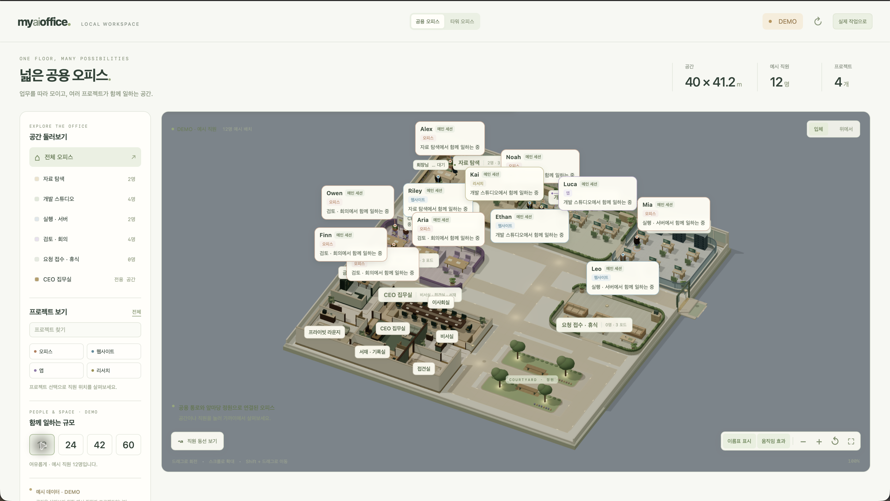

[English](README.md) | [한국어](README.ko.md)

# My AI Office

My AI Office is a local app that visualizes your Codex activity as an office on your computer. Explore your projects and active sessions across floors and rooms.

## Quick start

Double-click the launcher in the project folder. You do not need to enter commands in a terminal or start the server separately.

- **Windows:** `Start My AI Office.bat`
- **macOS:** `Start My AI Office.command`

After a moment, the app opens in your browser at <http://127.0.0.1:4173>. Keep the server window open while using the app. To quit, close the server window on Windows or the terminal window opened by the launcher on macOS.

If macOS shows a confirmation dialog, choose **Open (열기)**.

### If the app does not start

The source repository downloaded from GitHub does not include Node.js. Install [Node.js 24 or later](https://nodejs.org/) and double-click the launcher again. You do not need to install npm packages separately.

A complete release ZIP can include the Node.js runtime needed to run the app, so no separate installation is required. If the app still asks you to install Node.js when using a release ZIP, make sure you downloaded the complete ZIP for your platform. The macOS launcher supports both Apple silicon and Intel Macs.

## Explore the app

The app shows your current Codex activity when it starts. To explore the interface before connecting a real session, turn on **Explore (둘러보기)**. Example staff and projects will appear, marked with `DEMO` so they are easy to distinguish from real data. Choose **Real work (실제 작업)** or **Go to real sessions (실제 세션으로)** to return to your Codex workspace.

### Shared office

Explore multiple projects and rooms together on one floor in a 3D office.

*This is a screenshot of the shared office using sample data from Explore mode. It contains no personal information.*

### Using the screen

1. Select **Shared Office (공용 오피스)** or **Tower Office (타워 오피스)** at the top to switch views.
2. Choose a room under **Explore Rooms (공간 둘러보기)** on the left, or select a project under **Projects (프로젝트 보기)**.
3. Select a staff member or a room in the 3D view to see its location and activity details.
4. Use the controls at the bottom of the screen to show name tags, toggle animations, zoom, or reset the camera view.

### 3D controls

| Input | Action |
| --- | --- |
| Drag | Rotate the 3D view |
| Mouse wheel or trackpad scroll | Zoom in or out |
| Drag while holding Shift | Pan the view |
| **Perspective / Top (입체 / 위에서)** | Switch the camera angle |

## Tower office

The tower office organizes projects by floor. Select a floor or project from the list on the left. Turn on **Active Floors Only (작업 층만)** to quickly find floors with active work. Select a room or staff member in the 3D office to inspect the activity in that space.

## Data and privacy

- The app runs on `127.0.0.1` so it can only be accessed from your computer.
- On first launch, the app automatically creates a `data/office.sqlite` database in the project folder.
- Codex session information is read from `~/.codex/sessions` on macOS and `%USERPROFILE%\.codex\sessions` on Windows. Original session files are not copied into the app database.
- The app does not display conversation contents. Check the screen before sharing or capturing it, since it may show real work details.
- `data/` may contain private work data. Do not share or commit this folder; it is excluded from Git.
- If the sessions folder does not exist or contains no sessions, the app will still start, but the activity view may be empty. You can still use Explore mode.

## Build a release ZIP

Run `node build-release.mjs` in a development environment to create a ZIP in `dist/`. Building a release ZIP requires platform-specific Node.js executables in `runtime/node/`. The ZIP does not include the developer's database or browser settings; it creates a new database on the computer where it is run.

## Project structure

- `public/`: Web interface, 3D scene, and Three.js files
- `server*.mjs`: Local server and Codex session processing
- `docs/design/`: Design documents and diagrams
- `tests/`: Automated tests
- `runtime/node/`: Node.js runtimes for release builds (excluded from Git)
- `data/`, `dist/`: Local data and generated release files (excluded from Git)

Third-party software notices for bundled assets and runtimes are provided alongside them.
